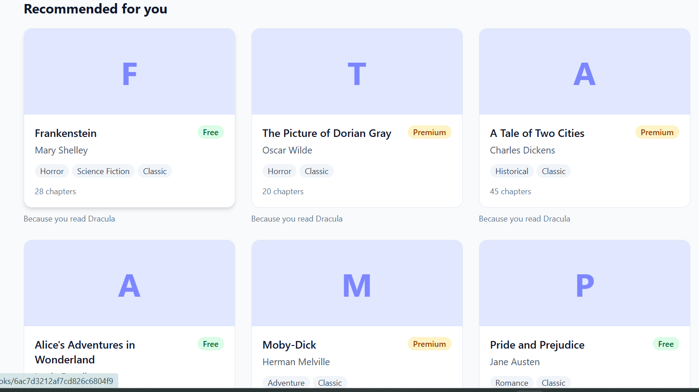
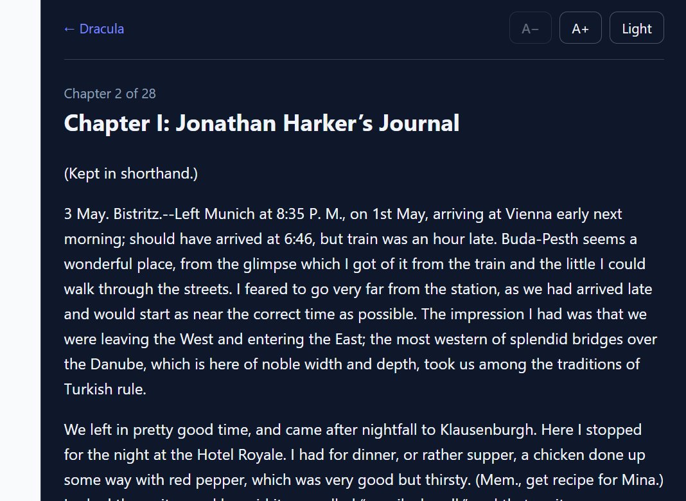
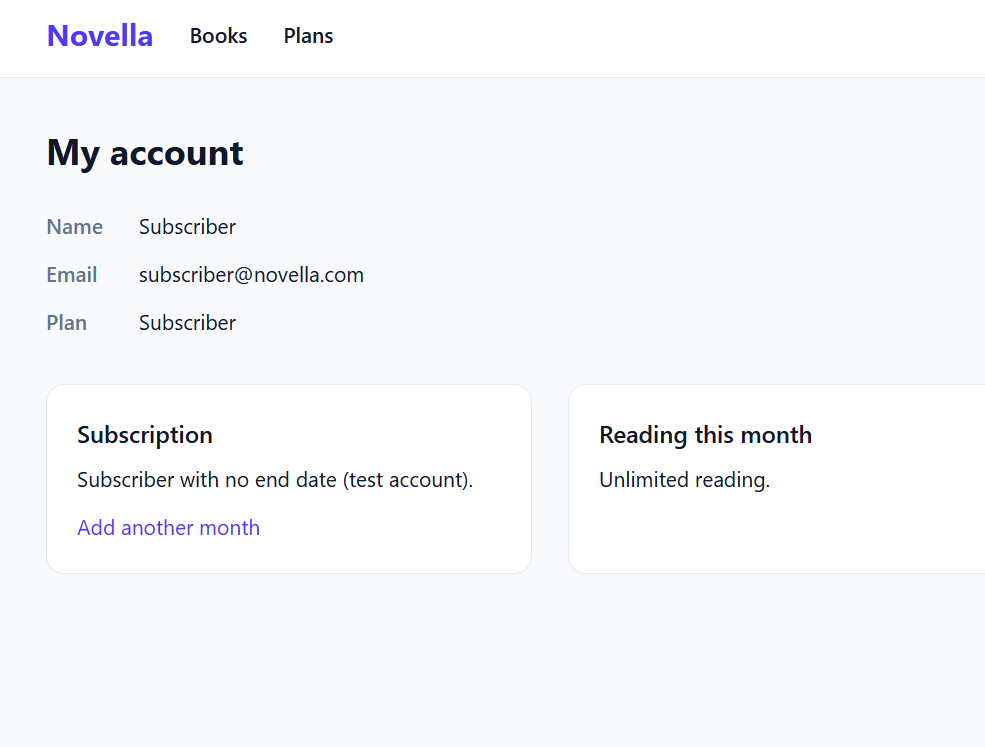
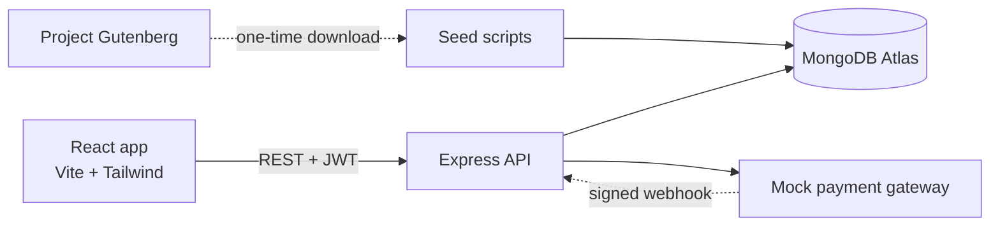

# Novella


An online library for classic books and web novels, with free and subscription access, reading progress, and personalised recommendations. Built with the MERN stack as a full-stack portfolio project.

**Live demo:** ADD_LINK_AFTER_DEPLOYMENT



| Catalogue | Reader (dark mode) |
|---|---|
|  |  |

## What it does

- **Three kinds of visitor:** guests can browse and search, free members can open a limited number of free books per month, and subscribers can read everything.
- **Server-enforced access:** premium books and the monthly limit are checked by the API on every request, not hidden in the UI.
- **Reader:** chapter pages with font size and dark mode, plus automatic bookmarks and a "continue reading" shelf.
- **Search and filters:** full-text search, genre and access filters, sorting and pagination, all stored in the URL so views can be shared.
- **Recommendations:** content-based ("Because you read Dracula"), with a popular-books fallback for new users.
- **Subscriptions:** monthly plan with order creation, signed payment confirmation and a webhook. Uses a **simulated payment gateway** (see limitations).
- **Admin page:** add and delete books.
- **Real content:** ten public-domain books from Project Gutenberg.

## Tech stack

| Part | Technology |
|---|---|
| Frontend | React, Vite, React Router, Tailwind CSS |
| Backend | Node.js, Express, REST API |
| Database | MongoDB (Atlas), Mongoose |
| Auth | JWT, bcrypt, role-based access control |
| Security | helmet, CORS allow-list, rate limiting, request size limit, input whitelisting |
| Tests and CI | Jest, Supertest, GitHub Actions |

## Architecture



Request flow on the API: `helmet` → CORS → rate limit → JSON body (1 MB max) → route → `protect` (verify JWT) → `authorize` (role) → controller → centralised error handler.

```
server/src
├── config/       database, plans, limits, environment checks
├── middleware/   auth, rate limiters, error handler
├── models/       User, Book, ReadingProgress, Subscription
├── controllers/  request handling
├── services/     recommender, payment gateway, subscription activation
├── routes/       URL definitions
└── seed/         sample data and the Gutenberg importer
client/src
├── api/          one helper for all server calls
├── context/      authentication state
├── components/   shared UI and route guards
└── pages/        catalogue, details, reader, plans, account, admin
```

## Getting started

You need Node.js 20 or newer and a free [MongoDB Atlas](https://www.mongodb.com/atlas) cluster.

```bash
git clone https://github.com/farhatkhan73750/novella-library.git
cd YOUR_REPO

# Backend
cd server
npm install
cp .env.example .env        # Windows: copy .env.example .env
# edit .env: add your MONGO_URI, JWT_SECRET, PAYMENT_SECRET, WEBHOOK_SECRET

npm run seed                # sample books
npm run seed:gutenberg      # real text (downloads once, then cached)
npm run seed:users          # test accounts
npm run seed:history        # demo readers for recommendations
npm run dev                 # http://localhost:5000

# Frontend (second terminal)
cd client
npm install
cp .env.example .env
npm run dev                 # http://localhost:5173
```

Generate secrets with: `node -e "console.log(require('crypto').randomBytes(32).toString('hex'))"`

**Test accounts** (created by `seed:users`, development only, password `password123`): `admin@novella.com`, `reader@novella.com`, `subscriber@novella.com`.

## API overview

| Method and path | Access | Purpose |
|---|---|---|
| `POST /api/auth/register`, `POST /api/auth/login` | Public | Create account, log in |
| `GET /api/auth/me` | Member | Current user |
| `GET /api/books`, `GET /api/books/:id` | Public | Search, filter, paginate, details |
| `POST`, `PUT`, `DELETE /api/books...` | Admin | Manage books |
| `GET /api/reading/:bookId/chapters/:n` | Member | Read a chapter (access rules, saves bookmark) |
| `GET /api/reading/quota`, `/history` | Member | Free-book usage, reading history |
| `GET /api/subscriptions/plans` | Public | Plans and prices |
| `POST /api/subscriptions/checkout`, `/confirm` | Member | Create an order, confirm a signed payment |
| `POST /api/subscriptions/webhook` | Gateway (signed) | Payment event, safe to repeat |
| `GET /api/subscriptions/me` | Member | Subscription status |
| `GET /api/recommendations` | Member | Personalised or popular books |

## Design decisions

- **Monthly limit without a counter.** Each reading record stores the month it was unlocked, and the API counts records for the current month. There's no reset job, and the records double as reading history.
- **Payments are verified, not trusted.** The server owns prices. A payment is accepted only with a valid HMAC signature (client confirmation) or a signed webhook checked against the raw request body. Activation is idempotent and uses an atomic status update, so repeated or simultaneous deliveries can't double-activate.
- **Expiry without a scheduler.** The auth middleware downgrades an expired subscriber on their next request.
- **Recommender as a pure function.** Genre, tag and author weights from a user's history, weighted by engagement (finished books count more), scored against unread books. Being pure, it's unit-tested and reusable in the offline evaluation.
- **The UI is a convenience, the server is the judge.** Route guards hide pages, but every restriction is enforced and tested in the API.

## Testing

```bash
cd server
npm test
```

87 tests (Jest and Supertest) run against a separate `novella_test` database. The suite refuses to run unless the database name ends in `_test`. They cover authentication and roles, catalogue queries and NoSQL-injection inputs, admin-only changes, premium access and the free monthly limit, payment signatures, webhook tampering and repeats, expiry, recommendation scoring, rate limiting, body size limits and the Gutenberg parser. GitHub Actions runs them, plus a production build of the frontend, on every push.

**Recommender evaluation** (`npm run eval:recs`): leave-one-out hit rate at 3 was 67% against about 40% for random guessing. This uses a tiny synthetic dataset, so it validates the method and isn't evidence of production quality.

## Known limitations

Listed honestly, with what I would do next:

- **Simulated payment gateway.** No real money moves. A Razorpay or Stripe adapter would replace one file, and their checkout would replace the mock "Pay" button. The mock routes must stay disabled in a real deployment.
- **Single long-lived token in localStorage.** I'd move to short-lived access tokens plus refresh tokens in httpOnly cookies, with CSRF protection.
- **No email verification or password reset.**
- **Rate-limit counters live in server memory.** A shared store such as Redis would be needed for several instances.
- **Chapters are embedded in the book document.** Fine for these books, but a web novel with thousands of chapters would need a separate chapters collection, because of the 16 MB document limit.
- **Search covers title, author, description and tags, not chapter text.** Atlas Search or Elasticsearch would add that, plus typo tolerance.
- **Recommendations are content-based only,** and common tags such as "classic" carry little signal. I'd add TF-IDF weighting and collaborative filtering once there is real usage data.
- **Free-tier month resets on UTC calendar months.**
- **No browser end-to-end tests.** Playwright would cover the React app.

## Credits

Book texts are from [Project Gutenberg](https://www.gutenberg.org), where these works are in the public domain in the United States. The license header and footer are removed from the text in the app.